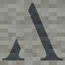

# ApolloCarpetAdditions

ApolloCarpetAdditions is an extension to [Carpet mod] by [Apollotech SMP RU minecraft server]

[Carpet mod]: https://github.com/gnembon/fabric-carpet
[Apollotech SMP RU minecraft server]: https://discord.gg/xtUtuQjrkz

# Carpet rules:

## pigCannonUnstuck
Fixed chunk loading behavior when player is a passenger of a very fast entity.
* Type: `Boolean`
* Default value: `false`
* Allowed options: `true`, `false`
* Categories: `APOLLO`, `BUGFIX`

## lazyLinkingPre1_21Render
Returns the behavior of server sending packets with entity coordinates (MC-170907). This fixes lazy linking mob render.
* Type: `Boolean`
* Default value: `false`
* Allowed options: `true`, `false`
* Categories: `APOLLO`, `BUGFIX`

## blockUpdateSuppressionLagFix
Removes lag from creating crash reports from block update suppression.
* Type: `Boolean`
* Default value: `false`
* Allowed options: `true`, `false`
* Categories: `APOLLO`, `OPTIMIZATION`

## fakePlayerChunkLoadingPriority
Prioritizes loading chunks around Carpet mod fake player over real players. May cause the server to crash if used with world generation or optimization mods.
* Type: `Boolean`
* Default value: `false`
* Allowed options: `true`, `false`
* Categories: `APOLLO`, `EXPERIMENTAL`

## StopSendPlayerSupportBlocks
Fixes MC-311727 or 'Player standing on air - force-sending blocks below' message in server console
* Type: `Boolean`
* Default value: `false`
* Allowed options: `true`, `false`
* Categories: `APOLLO`, `BUGFIX`

## instamineDeepslateWithNetheritePickaxe
A player with a block breaking speed of 49 or higher (at least netherite pickaxe with efficiency 5 and haste 2 effect) can instamine deepslate.
* Type: `Boolean`
* Default value: `false`
* Allowed options: `true`, `false`
* Categories: `APOLLO`, `SURVIVAL`

## endGatewaysLoadChunks
End gateways load chunks when an entity teleports through them.
* Type: `Boolean`
* Default value: `true`
* Allowed options: `true`, `false`
* Categories: `APOLLO`, `FEATURE`

## spawnParticlesWhenSpectatorGameModeChanged
Spawns a small cloud of white particles when a player switches their game mode to or from spectator mode.
* Type: `SpectatorGameModeChangeOptions`
* Default value: `FALSE`
* Allowed options: `FALSE`, `BOTH`, `TO`, `FROM`
* Categories: `APOLLO`

## playerCommandNonOperatorSpawnInGamemode
Specifies in which gamemodes non-operators can spawn players with /player command.
* Type: `GamemodesOptions`
* Default value: `NONE`
* Allowed options: `NONE`, `SURVIVAL`, `SPECTATOR`, `SURVIVAL_SPECTATOR`, `ALL`
* Categories: `APOLLO`, `COMMAND`, `SURVIVAL`

## allowEditOtherPlayersMacros
Determines what permission level allows editing other players' macros via /macro command.
* Type: `String`
* Default value: `ops`
* Allowed options: `true`, `false`, `ops`, `1`, `2`, `3`, `4`
* Categories: `APOLLO`, `COMMAND`

## newTimeArgumentValues
Adds new values for the time argument in commands such as /tick sprint. New values are: 1m = 1200 ticks, 1h = 72000 ticks.
* Type: `Boolean`
* Default value: `false`
* Allowed options: `true`, `false`
* Categories: `APOLLO`, `COMMAND`

## commandMacro
Allows to create and execute a sequence of commands with a delay.
* Type: `String`
* Default value: `ops`
* Allowed options: `true`, `false`, `ops`, `1`, `2`, `3`, `4`
* Categories: `APOLLO`, `COMMAND`

# Commands:

## /macro
Allows to create and execute a sequence of commands with a delay.
### Usage:
`[macro selection]` means that you can type one of three options:
* `mine {name}` - your macro.
* `public {name}` - public macro.
* `private {owner} {name}` - macro of a specific player.

### standard commands:

* `/macro create {name}` Creates macro.
* `/macro delete [macro selection]` Deletes macro.
* `/macro info [macro selection]` Displays all information about the macro.
* `/macro list [macro selection without {name}]` Displays a list of macros belonging to the corresponding owner.
* `/macro stop` Cancels the currently running macro.
* `/macro run {name} {variables}` Launches a macro that you own.
* `/macro run [macro selection without mine] {variables}` Launches other macros.  

`{variables}` is optional

### edit commands:

* `/macro edit [macro selection] rename {new name}` Renames macro.
* `/macro edit [macro selection] add {delay} {command}` Adds a new command to the macro, with a delay before its execution.
* `/macro edit [macro selection] remove {command number}` Removes a command from the macro.
* `/macro edit [macro selection] replace {command number} {delay} {command}` Replaces a command in the macro.
* `/macro edit [macro selection] transfer {new owner}` transfers ownership of a macro to another player or makes it public.

### examples:
`/macro create turnMobSwitchWithBot`  
`/macro edit mine turnMobSwitchWithBot add 0t player mob_switch spawn at 217 64 918 facing 90 0 in minecraft:the_nether in survival`  
`/macro edit mine turnMobSwitchWithBot add 5s player mob_switch use once`  
`/macro edit mine turnMobSwitchWithBot add 1s player mob_switch kill`  
`/macro edit mine turnMobSwitchWithBot transfer public`
`/macro run public turnMobSwitchWithBot`

Spawns Carpet bot at 217 64 918, makes it use once and kills it.

`/macro create say_my_name`
`/macro edit mine say_my_name add 0t /say $name`
`/macro edit mine say_my_name add 5s /say $right`
`/macro run say_my_name $name=Heisenberg $right=You are goddamn right`

Makes you say "Heisenberg" and after 5 seconds "You are goddamn right".

# Other:

